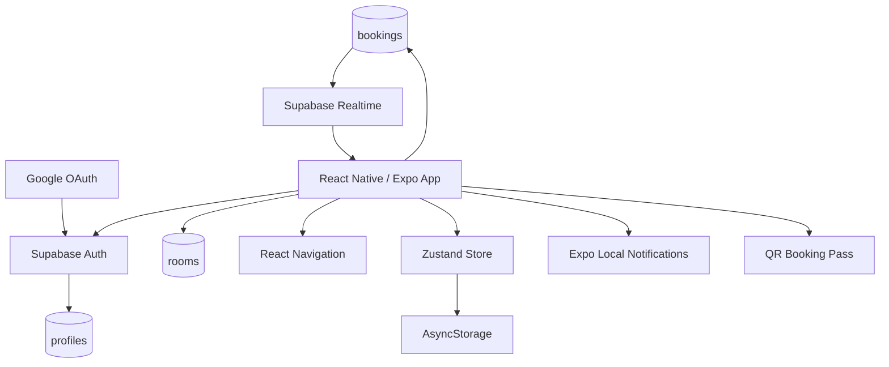
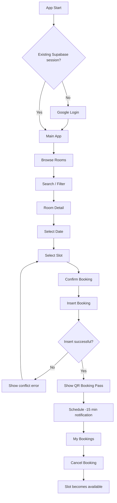
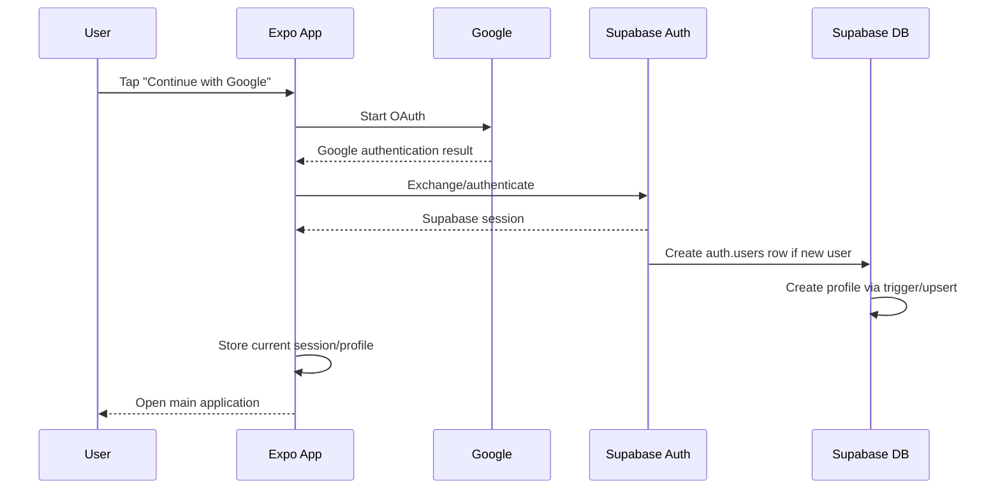
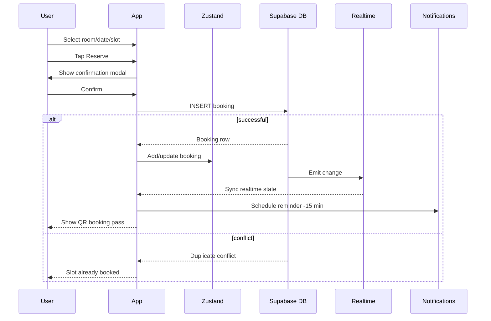

# ANTIGRAVITY IMPLEMENTATION PLAN
## VKU Real-time Study Room Booking App
### React Native + Expo + TypeScript + Zustand + Supabase + Google Auth

---

# 0. INSTRUCTIONS FOR THE IMPLEMENTATION AGENT

You are implementing a complete Mini-Project named:

**VKU Study Room Booking**

The project is a mobile application for VKU students to discover study rooms/computer labs, see real-time room availability, reserve a room for a predefined 2-hour slot, receive a local reminder before the booking starts, and display a QR booking pass.

The application MUST focus on the React Native / Expo requirements of the assignment. Do NOT over-engineer the backend. Supabase is the Backend-as-a-Service and replaces a custom Node.js / Express backend.

## Mandatory implementation principles

1. Use **React Native + Expo + TypeScript**.
2. Use **React Navigation**, not Expo Router, unless the existing project is already based on Expo Router.
3. Use **Zustand** for global application state.
4. Use **AsyncStorage** for persistence of application preferences and notification mappings.
5. Use **Supabase Auth with Google Login**.
6. Use **Supabase PostgreSQL** for persistent application data.
7. Use **Supabase Realtime** to synchronize booking changes between devices.
8. Use **Supabase Row Level Security (RLS)**.
9. Use **expo-notifications** for local reminders 15 minutes before booking time.
10. Use a QR library to render a QR booking pass.
11. Use **FlatList** for the room list and optimize rendering.
12. Prevent double booking at the **database level**, not only in the UI.
13. Keep the project within Mini-Project scope. Do NOT add payment, chat, AI recommendation, admin dashboard, push notification server, maps, ratings, or QR scanning unless all mandatory requirements are already complete.
14. Use strict TypeScript and avoid `any` unless absolutely necessary.
15. Do not store Supabase service-role keys, Google Client Secret, database passwords, or any privileged key in the mobile application.
16. Prefer simple, maintainable, modular code over unnecessary abstractions.

---

# 1. PROJECT GOAL

Build a high-performance campus study room reservation application where:

- A student signs in using Google.
- The student discovers study rooms and computer labs.
- Rooms can be searched and filtered by:
  - building,
  - capacity,
  - equipment.
- The student selects one of the next 7 days.
- The student selects one of four predefined 2-hour time slots.
- Already-booked slots are disabled.
- Availability updates in real time across multiple devices.
- The database guarantees that only one active booking can exist for:
  - one room,
  - one date,
  - one slot.
- A successful reservation creates a QR booking pass.
- A local notification is scheduled 15 minutes before the reservation.
- The student can review and cancel future bookings.
- Canceling a booking releases the slot and cancels the corresponding local reminder.

---

# 2. NON-GOALS

Do NOT implement the following in the first complete version:

- Custom Node.js backend
- Express / NestJS backend
- Firebase
- Redis
- Dockerized backend
- Payment
- Admin dashboard
- Room approval workflow
- Room ratings
- Room favorites
- Chat
- AI recommendations
- Map navigation
- QR scanner
- Attendance tracking
- Remote push notifications
- Calendar synchronization
- Complex RBAC
- Analytics dashboard

---

# 3. FINAL TECH STACK

## Mobile

- React Native
- Expo
- TypeScript
- React Navigation
- Zustand
- `@react-native-async-storage/async-storage`
- `expo-notifications`
- `expo-web-browser`
- Expo linking/deep-link support
- QR rendering library
- `react-native-svg` if required by QR package

## Backend / BaaS

Supabase:

- Authentication
- Google OAuth
- PostgreSQL
- Realtime
- Row Level Security

## Development / Delivery

- Git
- GitHub
- Expo Development Build / EAS Build
- Android APK for demonstration if possible

---

# 4. SYSTEM ARCHITECTURE



---

# 5. HIGH-LEVEL APPLICATION FLOW



---

# 6. AUTHENTICATION FLOW

## Required behavior

The user MUST authenticate with Google.

No email/password registration screen is required unless explicitly requested later.

## Flow



## Required auth behaviors

- Detect existing session on app start.
- Restore session after app restart.
- Listen to Supabase auth state changes.
- Navigate authenticated users to Main App.
- Navigate signed-out users to Login screen.
- Sign out through Supabase.
- Clear local user-related state on logout.
- Clean up realtime subscriptions on logout.

## Google OAuth setup

Use an Expo development build / APK when testing Google OAuth on physical devices.

The project should define a custom URL scheme such as:

```text
vku-study-room
```

Example callback/deep-link target:

```text
vku-study-room://auth/callback
```

Do not depend on Expo Go as the only final demo environment for Google authentication.

---

# 7. USER PROFILE MODEL

Supabase already maintains `auth.users`.

Create a lightweight public application table:

```sql
create table if not exists public.profiles (
  id uuid primary key references auth.users(id) on delete cascade,
  full_name text,
  email text,
  avatar_url text,
  student_code text,
  created_at timestamptz not null default now(),
  updated_at timestamptz not null default now()
);
```

`student_code` is optional and can remain null in v1.

The application should use:

- `auth.users` for authentication identity.
- `profiles` for app-facing profile information.

---

# 8. DATABASE SCHEMA

The minimum application schema contains:

- `profiles`
- `rooms`
- `bookings`

## 8.1 rooms

Recommended schema:

```sql
create table if not exists public.rooms (
  id uuid primary key default gen_random_uuid(),
  code text not null unique,
  name text not null,
  building text not null,
  floor integer not null,
  capacity integer not null check (capacity > 0),
  equipment text[] not null default '{}',
  image_url text,
  created_at timestamptz not null default now()
);
```

Example:

```json
{
  "code": "A201",
  "name": "Study Room A201",
  "building": "A",
  "floor": 2,
  "capacity": 8,
  "equipment": ["projector", "whiteboard", "ac"]
}
```

## 8.2 bookings

Recommended schema:

```sql
create table if not exists public.bookings (
  id uuid primary key default gen_random_uuid(),
  user_id uuid not null references auth.users(id) on delete cascade,
  room_id uuid not null references public.rooms(id) on delete cascade,
  booking_date date not null,
  slot_id text not null,
  status text not null default 'active'
    check (status in ('active', 'cancelled')),
  created_at timestamptz not null default now(),
  cancelled_at timestamptz
);
```

---

# 9. TIME SLOT MODEL

Do NOT create a database table for fixed time slots unless required later.

Use constants in the client:

```ts
export type SlotId = 'S1' | 'S2' | 'S3' | 'S4';

export const TIME_SLOTS = [
  {
    id: 'S1',
    start: '07:30',
    end: '09:30',
  },
  {
    id: 'S2',
    start: '09:30',
    end: '11:30',
  },
  {
    id: 'S3',
    start: '13:00',
    end: '15:00',
  },
  {
    id: 'S4',
    start: '15:00',
    end: '17:00',
  },
] as const;
```

---

# 10. DATABASE-LEVEL CONFLICT PREVENTION

This is mandatory.

The UI checking that a slot is free is NOT sufficient.

Create a partial unique index:

```sql
create unique index if not exists unique_active_booking_slot
on public.bookings (
  room_id,
  booking_date,
  slot_id
)
where status = 'active';
```

This guarantees:

```text
(room_id + booking_date + slot_id + active)
```

can only exist once.

## Why a partial unique index is required

Cancelled bookings should stay in the database for history.

A normal UNIQUE constraint would keep cancelled bookings blocking the slot.

The partial unique index applies only to:

```text
status = 'active'
```

Therefore:

- active booking => slot locked,
- cancelled booking => slot released.

---

# 11. RACE-CONDITION BEHAVIOR

The app MUST correctly handle:

```text
Phone A and Phone B both see the same slot as available.
Both press Reserve almost simultaneously.
```

Expected result:

```text
Phone A -> insert succeeds
Phone B -> database duplicate conflict
```

OR vice versa.

Exactly one active booking must exist.

On duplicate conflict:

Show a user-friendly message:

```text
This time slot has just been booked by another student.
Please choose another available time.
```

Do not show raw PostgreSQL errors.

Do NOT optimistically mark a booking as successful before the database confirms the insert.

---

# 12. ROW LEVEL SECURITY

Enable RLS on all exposed application tables.

```sql
alter table public.profiles enable row level security;
alter table public.rooms enable row level security;
alter table public.bookings enable row level security;
```

## 12.1 profiles policies

Users should be able to read/update their own profile.

Concept:

```sql
auth.uid() = id
```

## 12.2 rooms policies

Authenticated users:

- SELECT allowed.
- INSERT denied from mobile.
- UPDATE denied from mobile.
- DELETE denied from mobile.

Room data is seeded/admin-managed.

## 12.3 bookings policies

Authenticated users should:

- be able to read booking data necessary to determine occupied slots,
- insert only a booking whose `user_id = auth.uid()`,
- update/cancel only their own booking,
- not hard-delete bookings from the client.

For UPDATE policies, use both ownership condition and `WITH CHECK`.

Do not expose any privileged Supabase key to the mobile client.

---

# 13. ROOM AVAILABILITY STRATEGY

Availability is derived, not stored as a permanent room status.

## Room "Available Now" behavior

Determine the current date/time.

Map the current time to one predefined slot.

Example:

```text
08:15 -> S1 (07:30-09:30)
```

If an active booking exists for:

```text
room + today + current slot
```

then:

```text
Occupied
```

Otherwise:

```text
Available Now
```

If current time is outside all valid booking slots, use a neutral state such as:

```text
No active session
```

or calculate availability for the next valid slot.

Keep this behavior consistent across the UI.

---

# 14. REALTIME SYNCHRONIZATION

Subscribe to booking changes using Supabase Realtime.

Listen for:

- INSERT
- UPDATE
- DELETE if needed

Primary behavior:

```text
Phone A books A201 / date / S2
-> booking row inserted
-> Supabase realtime event
-> Phone B receives event
-> Phone B updates local booking state
-> S2 becomes disabled without manual refresh
```

Cancellation:

```text
Phone A changes booking.status to cancelled
-> realtime UPDATE
-> Phone B receives event
-> slot becomes available
```

## Realtime lifecycle

Start subscription after user session is authenticated.

Stop subscription:

- on logout,
- when provider/store is destroyed,
- when replacing a subscription.

Avoid duplicate subscriptions.

---

# 15. SCREEN LIST

Required screens:

1. `LoginScreen`
2. `RoomDiscoveryScreen`
3. `RoomDetailScreen`
4. `MyBookingsScreen`
5. `ProfileScreen`

Required modal/components:

- Booking confirmation modal
- Filter modal/bottom sheet if needed
- QR booking pass modal

Optional:

- Splash/Auth gate screen

---

# 16. NAVIGATION DESIGN

Recommended:

```text
RootNavigator
|
+-- AuthStack
|   |
|   +-- LoginScreen
|
+-- AppStack
    |
    +-- MainTabs
    |   |
    |   +-- RoomDiscoveryScreen
    |   +-- MyBookingsScreen
    |   +-- ProfileScreen
    |
    +-- RoomDetailScreen
    +-- QRPassModal
```

Protected navigation:

```text
No valid Supabase session
-> AuthStack

Valid Supabase session
-> AppStack
```

---

# 17. LOGIN SCREEN SPECIFICATION

UI:

```text
--------------------------------
          VKU STUDY ROOM

      Find. Reserve. Study.

   [ G  Continue with Google ]

      Campus Room Reservation
--------------------------------
```

Requirements:

- Show app name/logo.
- Google login button.
- Disable login button while login is in progress.
- Show user-friendly auth errors.
- If auth is canceled, remain on LoginScreen.
- Do not expose raw OAuth errors to user.

---

# 18. ROOM DISCOVERY SCREEN

This is the primary home screen.

Required UI:

```text
Header
Search
Building chips
Capacity filter
Equipment filter
Result count
Room FlatList
Bottom navigation
```

Each room card shows:

- Room photo
- Room code/name
- Building
- Floor
- Capacity
- Equipment summary
- Current real-time status

Example:

```text
A201                  Available Now
Building A · Floor 2
Capacity: 8

Projector · Whiteboard · AC
```

---

# 19. ROOM SEARCH

Search should match:

- room code,
- room name,
- optionally building.

Example:

```text
A201
study
lab
```

Filtering should occur locally after rooms are loaded.

Do not send a network query on every keystroke.

Use memoized filtering.

---

# 20. FILTER SPECIFICATION

## Building

Allowed values:

```text
A
B
C
V
```

Support multi-select.

## Capacity

Recommended ranges:

```text
Any
2-4
5-8
9-12
13-20
```

## Equipment

Supported:

```text
projector
whiteboard
high_spec_pc
ac
```

Multiple selected equipment filters should use AND semantics:

```text
Projector + AC
```

means the room must contain both.

---

# 21. FILTER PIPELINE

```text
allRooms
  |
  v
search
  |
  v
building
  |
  v
capacity
  |
  v
equipment
  |
  v
filteredRooms
  |
  v
FlatList
```

Use `useMemo`.

Avoid repeatedly recomputing heavy filtering in every render.

---

# 22. FLATLIST PERFORMANCE REQUIREMENTS

The assignment explicitly evaluates performance.

Use:

- `FlatList`
- stable `keyExtractor`
- `React.memo(RoomCard)`
- `useMemo`
- `useCallback`
- lightweight item components
- optimized images
- reasonable `initialNumToRender`
- reasonable `windowSize`
- `getItemLayout` if row/card height is fixed
- avoid inline component definitions in `renderItem`
- avoid unnecessary global state subscriptions in each card

Development benchmark:

Generate approximately:

```text
300-500 mock rooms
```

and verify fast scrolling remains smooth.

Production/seed room count can be smaller.

---

# 23. ROOM DETAIL SCREEN

Required sections:

1. Hero room image.
2. Room code/name.
3. Building/floor.
4. Capacity.
5. Equipment.
6. 7-day date selector.
7. Time-slot selector.
8. Reserve button.

Example layout:

```text
--------------------------------
< A201

[ ROOM IMAGE ]

A201
Building A · Floor 2
Capacity: 8

Projector | Whiteboard | AC

Select Date

Thu  Fri  Sat  Sun  Mon  Tue  Wed
24   25   26   27   28   29   30

Select Time

[07:30-09:30] [Booked]
[13:00-15:00] [15:00-17:00]

       [ Reserve Room ]
--------------------------------
```

---

# 24. 7-DAY DATE SELECTOR

Do not install a heavy calendar library.

Generate:

```text
today
today + 1
today + 2
...
today + 6
```

Use a horizontal list/scroll area.

Store dates internally in a stable format such as:

```text
YYYY-MM-DD
```

Display localized readable labels separately.

---

# 25. SLOT UI STATES

A time slot can be:

## Available

Clickable.

## Selected

Highlighted.

## Booked

Disabled.

## Past

Disabled.

Past rule:

- If selected date is today,
- disable any slot whose end/start time is already invalid for booking.

Do not allow booking in the past.

---

# 26. BOOKING FLOW



---

# 27. BOOKING CONFIRMATION MODAL

Display:

- Room
- Date
- Time
- Confirm button
- Cancel button

Example:

```text
Confirm Reservation

Room:
A201

Date:
26 Sep 2026

Time:
09:30 - 11:30

[Cancel]   [Confirm]
```

Disable Confirm while insertion is pending.

Prevent double tap.

---

# 28. BOOKING STATUS MODEL

Use only:

```text
active
cancelled
```

for v1.

Do not add unnecessary workflow states.

---

# 29. MY BOOKINGS SCREEN

Show current user's bookings.

Sections:

- Upcoming
- Cancelled/Past optional

Each active booking card should show:

- Room
- Building
- Date
- Time
- Status
- Show QR
- Cancel

Example:

```text
A201
26 Sep 2026
09:30 - 11:30

[Show QR] [Cancel]
```

---

# 30. CANCELLATION FLOW

Do not delete the row.

Update:

```text
status = 'cancelled'
cancelled_at = now()
```

Then:

1. update local state,
2. realtime publishes the change,
3. other devices release the slot,
4. local scheduled reminder is cancelled,
5. notification mapping is deleted.

---

# 31. QR BOOKING PASS

The QR must identify the booking, but must not expose:

- Google tokens,
- JWT,
- access tokens,
- private user data.

Recommended payload:

```text
vku-study-room://booking/<booking-id>
```

or simply:

```text
VKU:<booking-id>
```

The QR screen should also display readable reservation details.

---

# 32. QR MODAL SPECIFICATION

Show:

- Booking Pass title
- QR code
- Room code/name
- Building/floor
- Date
- Time
- Short booking reference if desired
- Close/Done button

QR scanning is NOT required.

---

# 33. LOCAL NOTIFICATIONS

Use `expo-notifications`.

When a booking is successfully confirmed:

1. determine slot start datetime,
2. subtract 15 minutes,
3. schedule local notification.

Example:

```text
Booking: 15:00
Reminder: 14:45
```

Notification content:

```text
Study Room Reminder

Your reservation at Room A201 starts in 15 minutes.
```

---

# 34. NOTIFICATION MAPPING

Notification IDs are device-specific.

Do NOT store notification IDs as canonical booking data in Supabase.

Store locally:

```text
bookingId -> notificationId
```

using AsyncStorage.

Example key:

```text
booking_notification_map
```

---

# 35. NOTIFICATION EDGE CASES

If:

```text
start time = 15:00
current time = 14:52
```

then the normal 14:45 reminder has already passed.

Recommended behavior:

```text
if reminderTime > now:
    schedule at reminderTime
else if startTime > now:
    optionally schedule a near-immediate "starts soon" notification
else:
    do not allow booking because slot is already in the past
```

Do not crash when notification permission is denied.

Booking should still succeed even if notification permission is denied.

Show a non-blocking explanation.

---

# 36. ZUSTAND STORE DESIGN

Required store name:

```text
useBookingStore
```

Recommended state:

```ts
interface BookingStoreState {
  session: Session | null;
  profile: Profile | null;

  rooms: Room[];
  bookings: Booking[];

  searchQuery: string;
  selectedBuildings: string[];
  capacityFilter: CapacityFilter | null;
  selectedEquipment: Equipment[];

  roomsLoading: boolean;
  bookingsLoading: boolean;
  bookingSubmitting: boolean;

  error: string | null;
}
```

Recommended actions:

```ts
setSession()
setProfile()

loadRooms()
loadBookings()

setSearchQuery()
toggleBuilding()
setCapacityFilter()
toggleEquipment()
resetFilters()

createBooking()
cancelBooking()

handleRealtimeBookingInsert()
handleRealtimeBookingUpdate()

clearUserState()
```

---

# 37. AUTH SOURCE OF TRUTH

Supabase Auth is the authentication source of truth.

Correct:

```text
Supabase Auth
   |
   v
Zustand session/profile
   |
   v
UI
```

Do NOT implement a fake auth state that can disagree with Supabase.

---

# 38. ASYNCSTORAGE PERSISTENCE

Persist:

- search/filter preferences,
- optional room cache,
- booking notification mapping,
- lightweight UX preferences.

Do NOT intentionally persist:

- loading flags,
- temporary modal state,
- transient API errors,
- selected temporary booking slot unless specifically desired.

Authentication session storage should be handled through the Supabase client configuration appropriate to Expo/mobile.

---

# 39. SERVICE LAYER

Use a thin service layer.

Suggested services:

```text
authService.ts
roomService.ts
bookingService.ts
notificationService.ts
```

## authService responsibilities

- sign in with Google
- get current session if needed
- sign out

## roomService

- fetch rooms

## bookingService

- fetch booking availability
- fetch user's bookings
- create booking
- cancel booking
- create/manage realtime booking subscription

## notificationService

- request permission
- schedule reminder
- cancel reminder
- maintain bookingId -> notificationId map

Do not create a massive generic repository abstraction.

---

# 40. RECOMMENDED PROJECT STRUCTURE

```text
vku-study-room/
|
+-- App.tsx
+-- app.json
+-- eas.json
+-- package.json
+-- tsconfig.json
+-- .env
+-- .env.example
+-- .gitignore
|
+-- assets/
|   +-- icon.png
|   +-- splash.png
|   +-- rooms/
|
+-- src/
    |
    +-- components/
    |   +-- RoomCard.tsx
    |   +-- SearchBar.tsx
    |   +-- FilterChip.tsx
    |   +-- BuildingFilter.tsx
    |   +-- CapacityFilter.tsx
    |   +-- EquipmentFilter.tsx
    |   +-- DateSelector.tsx
    |   +-- TimeSlotCard.tsx
    |   +-- TimeSlotGrid.tsx
    |   +-- BookingCard.tsx
    |   +-- BookingConfirmModal.tsx
    |   +-- QRPassModal.tsx
    |   +-- EmptyState.tsx
    |   +-- ErrorState.tsx
    |
    +-- screens/
    |   +-- LoginScreen.tsx
    |   +-- RoomDiscoveryScreen.tsx
    |   +-- RoomDetailScreen.tsx
    |   +-- MyBookingsScreen.tsx
    |   +-- ProfileScreen.tsx
    |
    +-- navigation/
    |   +-- RootNavigator.tsx
    |   +-- AuthNavigator.tsx
    |   +-- AppNavigator.tsx
    |   +-- MainTabNavigator.tsx
    |   +-- navigationTypes.ts
    |
    +-- stores/
    |   +-- useBookingStore.ts
    |
    +-- services/
    |   +-- supabase.ts
    |   +-- authService.ts
    |   +-- roomService.ts
    |   +-- bookingService.ts
    |   +-- notificationService.ts
    |
    +-- hooks/
    |   +-- useAuthBootstrap.ts
    |   +-- useRealtimeBookings.ts
    |   +-- useRoomAvailability.ts
    |
    +-- utils/
    |   +-- dateUtils.ts
    |   +-- bookingUtils.ts
    |   +-- filterUtils.ts
    |   +-- errorUtils.ts
    |
    +-- constants/
    |   +-- timeSlots.ts
    |   +-- equipment.ts
    |   +-- buildings.ts
    |
    +-- types/
        +-- auth.ts
        +-- room.ts
        +-- booking.ts
        +-- navigation.ts
```

If the project already has a reasonable structure, adapt instead of performing an unnecessary full rewrite.

---

# 41. TYPE DEFINITIONS

## Room

```ts
export type Equipment =
  | 'projector'
  | 'whiteboard'
  | 'high_spec_pc'
  | 'ac';

export interface Room {
  id: string;
  code: string;
  name: string;
  building: 'A' | 'B' | 'C' | 'V';
  floor: number;
  capacity: number;
  equipment: Equipment[];
  image_url: string | null;
  created_at: string;
}
```

## Booking

```ts
export type BookingStatus = 'active' | 'cancelled';

export interface Booking {
  id: string;
  user_id: string;
  room_id: string;
  booking_date: string;
  slot_id: 'S1' | 'S2' | 'S3' | 'S4';
  status: BookingStatus;
  created_at: string;
  cancelled_at: string | null;
}
```

## Profile

```ts
export interface Profile {
  id: string;
  full_name: string | null;
  email: string | null;
  avatar_url: string | null;
  student_code: string | null;
}
```

---

# 42. ROOM FILTER LOGIC

Filtering should be deterministic.

Pseudo-code:

```ts
const filteredRooms = useMemo(() => {
  return rooms.filter((room) => {
    const matchesSearch =
      normalizedSearch.length === 0 ||
      room.code.toLowerCase().includes(normalizedSearch) ||
      room.name.toLowerCase().includes(normalizedSearch);

    const matchesBuilding =
      selectedBuildings.length === 0 ||
      selectedBuildings.includes(room.building);

    const matchesCapacity =
      matchesCapacityFilter(room.capacity, capacityFilter);

    const matchesEquipment =
      selectedEquipment.every((item) =>
        room.equipment.includes(item),
      );

    return (
      matchesSearch &&
      matchesBuilding &&
      matchesCapacity &&
      matchesEquipment
    );
  });
}, [
  rooms,
  normalizedSearch,
  selectedBuildings,
  capacityFilter,
  selectedEquipment,
]);
```

---

# 43. CURRENT STATUS DERIVATION

Implement a utility:

```text
getCurrentSlot(now)
```

Possible return:

```text
S1
S2
S3
S4
null
```

Then:

```text
isRoomOccupiedNow(roomId, bookings, now)
```

A booking only counts if:

```text
status === 'active'
booking_date === today
slot_id === currentSlot
room_id === roomId
```

---

# 44. ERROR HANDLING

Handle at minimum:

- No Internet
- Supabase unavailable
- Google auth canceled
- Google auth failure
- Session restoration failure
- Room fetch failure
- Booking fetch failure
- Duplicate booking conflict
- Unauthorized booking action
- Booking already cancelled
- Notification permission denied
- Realtime disconnected
- Unexpected API error

Use human-readable messages.

Never expose raw database or OAuth diagnostic information directly in production UI.

Logging to console in development is acceptable.

---

# 45. EMPTY STATES

Room search:

```text
No rooms found.
Try changing your search or filters.
```

My Bookings:

```text
No upcoming reservations.
Find a room and make your first booking.
```

---

# 46. LOADING STATES

Required:

- Auth bootstrap
- Google login
- Room list load
- Booking load
- Booking submission
- Cancellation

Disable action buttons while the corresponding action is pending.

---

# 47. OFFLINE BEHAVIOR

The app does not need full offline booking support.

Expected:

- local UI preferences remain available,
- cached data may remain visible if implemented,
- new reservation requires an internet connection.

If offline during reservation:

```text
You're offline.
Connect to the internet to make a reservation.
```

Do not queue offline booking requests because this could violate collision guarantees.

---

# 48. SEED DATA

Create representative room data across:

```text
A
B
C
V
```

Include capacity values ranging from:

```text
2 to 20
```

Include different equipment combinations.

Seed at least approximately 20-30 realistic rooms.

For performance testing, generate 300-500 mock rooms locally or through a development script.

---

# 49. REQUIRED TEST CASES

## Authentication

- TC-AUTH-01: New Google user can sign in.
- TC-AUTH-02: Existing user can sign in.
- TC-AUTH-03: Session survives app restart.
- TC-AUTH-04: Logout returns to LoginScreen.
- TC-AUTH-05: Canceling Google auth does not crash app.

## Room discovery

- TC-ROOM-01: Rooms load correctly.
- TC-ROOM-02: Search by room code.
- TC-ROOM-03: Search by room name.
- TC-ROOM-04: Filter by building.
- TC-ROOM-05: Filter by capacity.
- TC-ROOM-06: Filter by equipment.
- TC-ROOM-07: Combined filters.
- TC-ROOM-08: Reset filters.
- TC-ROOM-09: Empty results state.

## Booking

- TC-BOOK-01: Seven date choices generated.
- TC-BOOK-02: Past slots disabled.
- TC-BOOK-03: Available slot can be booked.
- TC-BOOK-04: Existing booked slot disabled.
- TC-BOOK-05: User can cancel own booking.
- TC-BOOK-06: Cancelled slot becomes available.

## Conflict

- TC-CONFLICT-01:
  - Phone A and Phone B attempt same room/date/slot.
  - Expected: exactly one succeeds.
  - Database active booking count must equal 1.

## Realtime

- TC-RT-01:
  - Phone A books slot.
  - Phone B sees slot disabled without refresh.
- TC-RT-02:
  - Phone A cancels.
  - Phone B sees slot available without refresh.

## Notifications

- TC-NOTIF-01: reminder scheduled 15 minutes before start.
- TC-NOTIF-02: cancel booking cancels reminder.
- TC-NOTIF-03: denied notification permission does not prevent booking.

## Persistence

- TC-PERSIST-01:
  - apply filters,
  - close app,
  - reopen,
  - filters remain.

## Performance

- TC-PERF-01:
  - render 300-500 rooms,
  - rapidly scroll,
  - use search/filter,
  - verify no obvious major frame drops.

---

# 50. IMPLEMENTATION PHASES

The agent should implement in this exact order unless an existing codebase requires a minor adjustment.

---

## PHASE 0 — INITIALIZATION

### Tasks

- Create Expo TypeScript project.
- Enable strict TypeScript.
- Install navigation.
- Create folder structure.
- Initialize Git repository.
- Create `.env.example`.
- Configure Supabase client.
- Verify Supabase connection.
- Add placeholder navigation.

### Definition of Done

- App runs.
- TypeScript compiles.
- Navigation works.
- Supabase connection is verified.
- No secrets committed.

Suggested commit:

```text
chore: initialize Expo TypeScript application
```

---

## PHASE 1 — GOOGLE AUTH

Do this early because OAuth configuration has external setup risk.

### Tasks

- Configure custom scheme.
- Configure Google OAuth.
- Configure Supabase Google provider.
- Implement LoginScreen.
- Implement auth bootstrap.
- Implement protected navigation.
- Implement session restoration.
- Implement logout.
- Implement profiles row creation/upsert.
- Test on physical Android via development build/APK.

### Definition of Done

- Google login works.
- New user appears in Supabase Auth.
- Profile exists.
- Restart keeps user signed in.
- Logout works.

Suggested commits:

```text
feat(auth): configure Supabase Google authentication
feat(auth): add protected navigation and session restoration
feat(profile): create user profile from authenticated session
```

---

## PHASE 2 — DATABASE + ROOMS

### Tasks

- Create `profiles`.
- Create `rooms`.
- Create `bookings`.
- Add indexes.
- Enable RLS.
- Create policies.
- Seed room data.
- Implement `roomService`.
- Implement room fetch.
- Implement `RoomCard`.
- Implement `RoomDiscoveryScreen`.
- Implement FlatList.

### Definition of Done

- Authenticated user can read rooms.
- Room feed renders from Supabase data.
- No room feed hardcoding.

Suggested commits:

```text
feat(db): add room and booking schema with RLS
feat(rooms): add room discovery FlatList
```

---

## PHASE 3 — SEARCH + FILTER + PERSISTENCE

### Tasks

- Add search.
- Add building filters.
- Add capacity filters.
- Add equipment filters.
- Add combined filter logic.
- Add Reset.
- Memoize filtered room list.
- Persist filter preferences through Zustand/AsyncStorage.

### Definition of Done

- All filters work.
- Combined filters work.
- Restart restores selected filters.

Suggested commit:

```text
feat(filters): add persistent room search and filters
```

---

## PHASE 4 — ROOM DETAIL + BOOKING ENGINE

### Tasks

- Implement RoomDetailScreen.
- Implement 7-day date selector.
- Implement four time slots.
- Disable past slots.
- Fetch bookings needed for availability.
- Disable already booked slots.
- Implement confirmation modal.
- Add partial unique index if not already created.
- Implement `createBooking`.
- Convert duplicate DB error to friendly conflict message.
- Implement MyBookings.
- Implement cancellation.
- Never hard-delete booking.

### Definition of Done

- User can book.
- User can cancel.
- Database prevents duplicate active bookings.
- Slot becomes free after cancellation.

Suggested commits:

```text
feat(booking): add date and time slot reservation flow
feat(booking): prevent duplicate active room bookings
feat(booking): add reservation cancellation
```

---

## PHASE 5 — REALTIME

### Tasks

- Subscribe to booking INSERT.
- Subscribe to booking UPDATE.
- Update Zustand from realtime events.
- Update slot state without refresh.
- Update "Available Now / Occupied".
- Clean up subscription.

### Definition of Done

Two devices synchronize booking changes without manual refresh.

Suggested commit:

```text
feat(realtime): synchronize room availability across devices
```

---

## PHASE 6 — QR + LOCAL NOTIFICATIONS

### Tasks

- Add QR library.
- Create QRPassModal.
- Generate safe QR payload.
- Request notification permissions.
- Schedule reminder at start - 15 minutes.
- Store bookingId -> notificationId mapping.
- Cancel notification on booking cancellation.
- Handle denied permission.

### Definition of Done

- Every active booking can show a QR pass.
- Reminder is scheduled.
- Cancellation removes scheduled reminder.

Suggested commits:

```text
feat(qr): add booking pass QR modal
feat(notifications): add reservation reminders
```

---

## PHASE 7 — PERFORMANCE + UX HARDENING

### Tasks

- Memoize RoomCard.
- Memoize filtered lists.
- Stabilize render callbacks.
- Optimize FlatList config.
- Add loading states.
- Add empty states.
- Add error states.
- Disable duplicate action presses.
- Test with 300-500 rooms.
- Verify no unnecessary renders.

### Definition of Done

- Smooth room feed.
- Predictable error handling.
- No obvious duplicate requests.

Suggested commit:

```text
perf(rooms): optimize FlatList and room card rendering
```

---

## PHASE 8 — SUBMISSION

### Tasks

- Create development build/APK.
- Capture screenshots.
- Record 2-3 minute video.
- Finalize README.
- Prepare 2-4 page PDF report.
- Ensure `.env` is not committed.
- Review repository history.
- Test installation instructions from a clean clone.

Suggested commits:

```text
docs: add setup architecture and demo instructions
docs: finalize mini-project submission
```

---

# 51. README REQUIREMENTS

README must include:

```text
# VKU Study Room Booking

## Overview
## Features
## Tech Stack
## Architecture
## Screenshots
## Database Schema
## Authentication
## Booking Conflict Prevention
## Realtime Synchronization
## Local Notifications
## Project Structure
## Installation
## Environment Variables
## Running the App
## Building APK
## Demo
## Known Limitations
## Contributors
```

---

# 52. ENVIRONMENT VARIABLES

Use an `.env.example` such as:

```text
EXPO_PUBLIC_SUPABASE_URL=
EXPO_PUBLIC_SUPABASE_PUBLISHABLE_KEY=
```

Never commit actual privileged secrets.

Never put these in client source:

```text
SUPABASE_SERVICE_ROLE_KEY
SUPABASE_SECRET_KEY
DATABASE_PASSWORD
GOOGLE_CLIENT_SECRET
```

---

# 53. DEMO VIDEO PLAN

Target duration:

```text
2-3 minutes
```

Recommended timeline:

```text
00:00 - 00:10
Launch application.

00:10 - 00:25
Google Login.

00:25 - 00:40
Room Discovery.

00:40 - 00:55
Search and filters.

00:55 - 01:10
Open Room Detail.

01:10 - 01:25
Show disabled booked slot.

01:25 - 01:40
Reserve available slot.

01:40 - 01:55
Show QR booking pass.

01:55 - 02:10
Open My Bookings.

02:10 - 02:30
Second device receives realtime slot lock.

02:30 - 02:45
Cancel booking.

02:45 - 02:55
Second device sees slot released.

02:55 - 03:00
Profile / Logout.
```

Best evidence:

```text
Phone A books a slot.
Phone B sees it become unavailable immediately.
Phone A cancels.
Phone B sees it become available immediately.
```

---

# 54. SHORT REPORT PLAN

Maximum 4 pages recommended.

## Page 1

- Problem
- Objectives
- Feature checklist
- Technology stack
- Login / Room discovery screenshots

## Page 2

- Architecture diagram
- Database model
- Google Auth
- Supabase integration

## Page 3

- FlatList optimization
- Zustand + AsyncStorage
- Conflict prevention
- Realtime synchronization

## Page 4

- QR booking pass
- Local notifications
- Testing results
- Limitations
- GitHub/demo/APK links or QR codes

---

# 55. RUBRIC MAPPING

| Requirement | Implementation |
|---|---|
| React Native / Expo | Expo TypeScript app |
| Google Login | Supabase Auth + Google |
| Room list | FlatList |
| Photos | image_url/assets |
| Building/floor | rooms fields |
| Capacity | rooms.capacity |
| Equipment | rooms.equipment |
| Available/Occupied | derived active bookings |
| Search | local memoized search |
| Building filter | multi-select |
| Capacity filter | range filter |
| Equipment filter | AND filter |
| 7-day selector | generated dates |
| 2-hour slots | static TIME_SLOTS |
| Conflict prevention | partial unique DB index |
| Realtime | Supabase Realtime |
| QR | booking-id based QR |
| Zustand | useBookingStore |
| AsyncStorage | filters + notification mapping |
| Cancellation | status -> cancelled |
| Local notifications | expo-notifications |
| Performance | memoized optimized FlatList |
| GitHub | public repository |
| Demo | APK/dev build + video |
| PDF | 2-4 page technical report |

---

# 56. ACCEPTANCE CRITERIA

The project is complete only when this full workflow succeeds:

```text
1. User opens app.
2. App checks Supabase session.
3. User signs in with Google if needed.
4. User reaches room discovery.
5. Rooms load from Supabase.
6. User searches and filters rooms.
7. User opens a room.
8. User selects one of the next 7 days.
9. User sees 4 fixed time slots.
10. Already-booked slot is disabled.
11. Past slot is disabled.
12. User selects an available slot.
13. User confirms booking.
14. Database guarantees no duplicate active booking.
15. Successful booking is stored.
16. Zustand is updated.
17. Other devices receive realtime update.
18. QR booking pass is displayed.
19. Local reminder is scheduled 15 minutes before.
20. Booking appears in My Bookings.
21. User can cancel.
22. Cancelled booking remains in history.
23. Slot becomes available after cancellation.
24. Other devices receive realtime cancellation update.
25. Scheduled reminder is cancelled.
26. App restart restores auth session.
27. Filter preferences persist.
28. Room FlatList remains smooth under a large test dataset.
29. Logout returns to LoginScreen.
30. No privileged keys are present in GitHub.
```

---

# 57. DEFINITION OF DONE FOR THE ENTIRE PROJECT

The project should not be considered finished until all items below are true:

```text
[ ] Google Login works on a physical device.
[ ] Session restoration works.
[ ] Logout works.
[ ] Room list is loaded from Supabase.
[ ] Search works.
[ ] Building filter works.
[ ] Capacity filter works.
[ ] Equipment filter works.
[ ] Filters persist through AsyncStorage.
[ ] Room detail screen works.
[ ] Seven-day selector works.
[ ] Four predefined slots work.
[ ] Past slots are disabled.
[ ] Existing bookings disable slots.
[ ] Database prevents double booking.
[ ] Two-device realtime sync works.
[ ] My Bookings works.
[ ] Cancellation works.
[ ] Cancellation releases the slot.
[ ] QR booking pass works.
[ ] Reminder notification works.
[ ] Cancellation removes reminder.
[ ] FlatList is optimized.
[ ] Error/loading/empty states exist.
[ ] RLS is enabled.
[ ] No client-side privileged secrets exist.
[ ] README is complete.
[ ] APK/development build is available.
[ ] Demo video is recorded.
[ ] Technical PDF report is completed.
```

---

# 58. IMPLEMENTATION BEHAVIOR FOR THE AGENT

While implementing:

1. Work phase by phase.
2. Do not skip authentication setup.
3. Do not skip RLS.
4. Do not skip the database uniqueness rule.
5. Do not replace real-time DB synchronization with only local Zustand state.
6. Do not replace Google Auth with fake/mock login.
7. Do not add an unnecessary custom backend.
8. Keep each module small and testable.
9. After each phase:
   - run TypeScript checks,
   - launch the app,
   - verify the phase's Definition of Done.
10. If a third-party API changed:
    - consult current official documentation,
    - use versions compatible with the installed Expo SDK.
11. For Expo native dependencies:
    - prefer `npx expo install <package>`.
12. Do not blindly upgrade packages unless required.
13. If an implementation choice conflicts with the mandatory Mini-Project requirements, follow the Mini-Project requirements.
14. Preserve clean Git history with meaningful commits.
15. Prefer correctness of booking concurrency over optimistic UI tricks.

---

# 59. FINAL PRODUCT SUMMARY

The final product should be a focused, production-style academic Mini-Project demonstrating:

- real Google authentication,
- protected mobile navigation,
- clean global state management,
- persistent preferences,
- high-performance room discovery,
- multi-parameter filtering,
- robust database-level reservation conflict prevention,
- realtime multi-device synchronization,
- QR reservation passes,
- local scheduled reminders,
- clean modular TypeScript architecture.

The most important technical proof points are:

```text
1. Google Auth + protected navigation
2. FlatList performance
3. Zustand + AsyncStorage
4. Database-level booking collision prevention
5. Supabase Realtime across two devices
6. Local reminder lifecycle
```

Do not dilute these core deliverables with unnecessary features.
